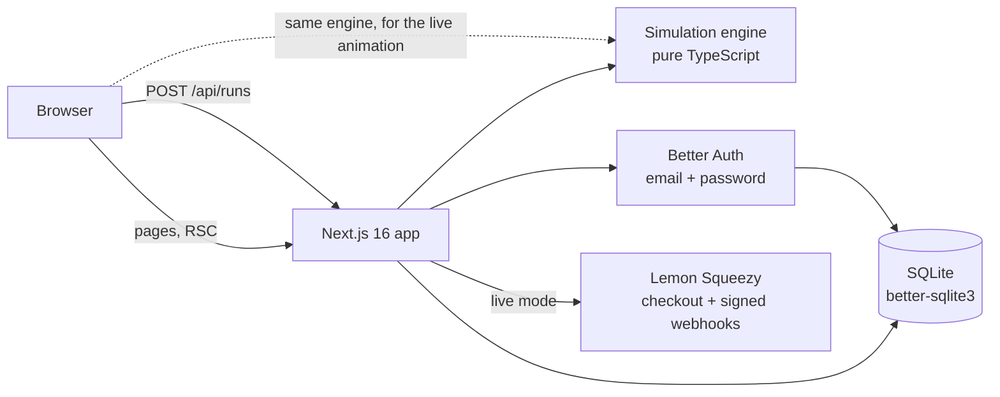

# System Sketch Lab - Technical design

## Architecture

| Layer | Choice | Why |
| --- | --- | --- |
| Web | Next.js 16 (App Router, Turbopack), React 19, Tailwind 4 | Same stack as the author's other projects; server components for per-user pages |
| Canvas | React Flow (`@xyflow/react`) | Mature node editor: drag, connect, zoom, keyboard delete |
| Engine | `src/engine/*`, no dependencies | Runs identically in the browser (animation) and on the server (scoring) |
| Auth | Better Auth, email + password, cookie sessions | Self-hosted, no per-user fees |
| Data | SQLite via better-sqlite3 | One file, zero ops; swap for Postgres when traffic needs it |
| Payments | Merchant of record (Lemon Squeezy) | Handles global tax; supports Bangladeshi payouts. Test mode ships a fake checkout |
| Tests | Vitest (engine, content, server), Playwright (end to end against a production build) | |

## Simulation model (`src/engine/simulate.ts`)

The model is a deterministic flow simulation evaluated once per simulated second (40 ticks by default).

1. **Traffic.** A scenario gives peak requests per second per class (`read`, `write`, `static`, `upload`, `loc`, `nearby`, `message`, `abuse`) and a curve (`steady`, `ramp`, `spike`, `wave`) that scales them each tick.
2. **Routing.** For each class the engine enumerates every path from Users through the design. Each component has an *action* per class: pass through, serve (with a hit ratio for caches 80% and CDNs 90%), queue, block (gateway on bot traffic) or reject. Dynamic classes must pass an App Server (or a Realtime Gateway for chat and location) before any data store. Next hops prefer specialised components (cache, then replicas for reads; CDN for static; geo index, then realtime gateway, then queue for location updates; queue for writes) and split equally among the preferred set. A cache or CDN with nothing behind it works cache-aside: misses fall back to the parent's other hops.
3. **Load and utilisation.** Load per node = sum over paths of rps x path probability x class weight (SQL writes cost 4 units, nearby searches 10 on databases, uploads 3 on app servers). Utilisation = load / (capacity per instance x live instances). A SQL Database's second instance is a standby, not capacity. App and realtime pools reached directly from Users or a CDN count as one instance (no load balancer to spread traffic).
4. **Outcome.** Each node passes `min(1, 1/u)` of its traffic (overload sheds the excess) and adds latency `base x 1/(1-u)` (capped at 25x). Path success and latency multiply and add along the path; p95 is a weighted percentile across all served requests.
5. **Queues.** Enqueued work accumulates per class; connected workers drain it at 300 jobs/s each into the stores behind them, and that drain adds load to those stores before success is computed. Lag = backlog / drain rate.
6. **Failures.** A failure removes instances from the first node of a type for a time window. Down nodes leave routing, so redundancy lets traffic flow around them.
7. **Diagnosis.** The engine returns issues in plain English: dead ends (and why), overloads (with a fix suggestion per component type), outages during failures, unbalanced pools, queue backlog, bot traffic reaching app servers, idle components.

Scoring (`src/engine/scoring.ts`): one star when availability, p95 and (optionally) queue-lag objectives pass; one more star for each of two stretch goals (credits, p95, failure-window availability or lag).

### Content guarantees (tested)

`src/content/content.test.ts` proves for every one of the 36 levels and stages that the hidden reference solution is valid, within budget and earns three stars, and that the starting design does not pass. Daily challenges are generated from six templates with a seeded RNG; an auto-solver sizes each day's budget, and the test suite checks 120 consecutive days are solvable. `pnpm levels:report` prints utilisation for every level while authoring.

## Data model (SQLite)

| Table | Purpose |
| --- | --- |
| `user`, `session`, `account`, `verification` | Better Auth (created by `pnpm db:migrate`) |
| `profile` | XP, streak, best streak, last active day, plan |
| `progress` | Best stars, credits, p95, availability and design per user and level; attempt count |
| `runs` | Every submitted run (history, analytics) |
| `badges` | Earned badges |
| `daily_scores` | Best daily result per user per day (leaderboard) |
| `billing_events` | Test checkouts and webhook events; event ids make webhooks idempotent |

## Request flow for a run

1. The browser simulates the design locally and animates 40 ticks.
2. On completion it `POST`s `{levelId, design}` to `/api/runs`.
3. The server resolves the level (daily ids only for today or earlier), checks Pro access and case-study stage order, validates the design against the palette and budget, **re-simulates it**, and records the result in one transaction: progress if improved, XP for newly earned stars only, streak, badges, daily score.
4. The response carries XP gained, rank, streak and new badges.

Clients never see reference solutions: the play page strips them before rendering.

## Security

- Server-side re-simulation; client scores are never trusted.
- Pro and stage gating enforced in page rendering and in the API.
- Post-login redirects accept only same-site relative paths.
- Webhooks verified with HMAC-SHA256 (`X-Signature`) using a constant-time compare; replays ignored.
- Test-mode checkout and cancellation refuse to run when `PAYMENTS_MODE=live`.

## Local environment notes

The author's Projects drive is NTFS over FUSE, which is very slow for `node_modules`. `pnpm-workspace.yaml` therefore keeps the package store and virtual store on the Linux disk, `.next` is a symlink to the same disk, and `turbopack.root` is `/` so Turbopack can compile packages outside the project folder. On a normal disk, delete the two `storeDir`/`virtualStoreDir` lines and the `turbopack.root` line.

## Deployment

Any Node host with a persistent disk (Fly.io volume, a small VPS, Railway) runs `pnpm build && pnpm db:migrate && pnpm start`. Set the variables in `.env.example`. SQLite is fine for tens of thousands of users; move to Postgres (Better Auth and the progress queries are plain SQL) before horizontal scaling.
